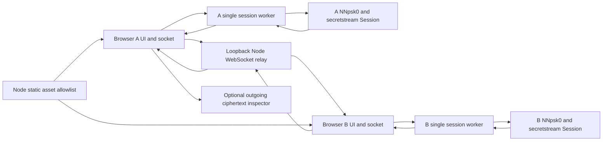
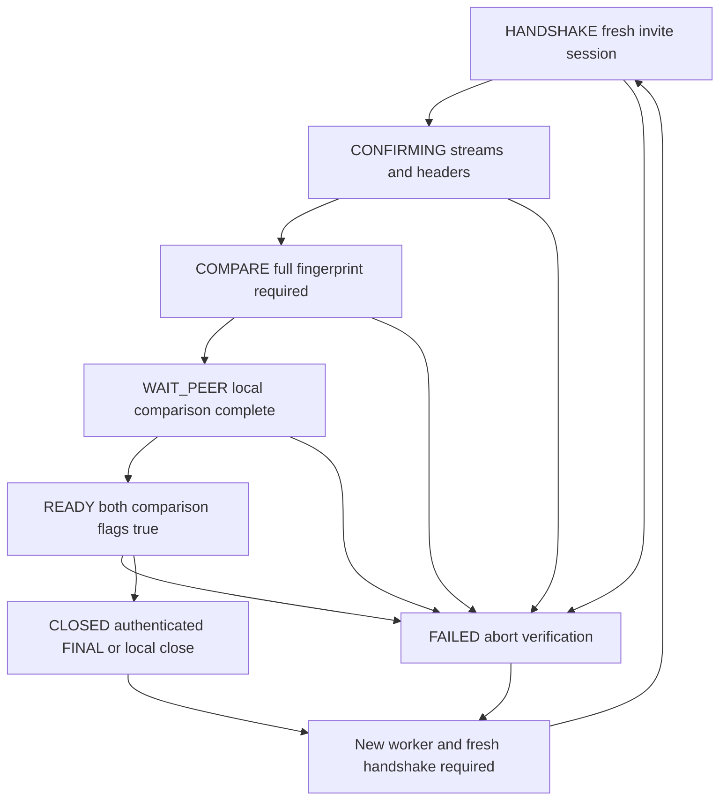

# Q6 — Glassbox: Technical Breakdown

**Rename note —** Glassbox is Wilson's final Q6 name; formerly the problem was described as “P2P encrypted chat,” not a separately evidenced brand. Its implemented transport is a relay. [P, title; `analysis/_inspo-notes.md`, Wilson's rules; README]

## 1. Final implementation status and evidence boundary

**IMPLEMENTED —** Glassbox is now a two-browser, text-only, ephemeral encrypted-chat prototype in `analysis/p6-prototype/`, backed by a local loopback WebSocket relay. It uses **Noise NNpsk0 for the bounded handshake only** and libsodium secretstream for application records. E2EE over this relay is **not WebRTC P2P**; the composition remains unaudited. Research remains in `analysis/p6-security/`. [README, opening and Security boundaries; TM, What is built; R1–R6]

**TESTED-REPORTED —** All runtime outcomes are the owners' records. Re-run by documentation agent: **no**. This pass only read source/reports/logs and used read-only inventory, grep and `wc -l`; it did not run tests, browsers, npm, servers or installers, or bind a port. IMPLEMENTED describes inspected code, not proven cryptographic security. [D, Hard rules; BS, Tested]

| Capability | Final evidence boundary | Status label |
| --- | --- | --- |
| Source, packaged local server, browser app and session worker | Real files listed in section 6; no React/TypeScript/Vite runtime. [PKG; `src/app.mjs`; `server.mjs`] | IMPLEMENTED |
| High-entropy invite / fragment import and strip | `newInvite`, `inviteMaterial`, `parseInvite`, `importFragment`; hashchange regression fixed. [`src/core.mjs`; `src/app.mjs`; BS, Actual defects] | IMPLEMENTED |
| Bounded NNpsk0 and independent direction vector | Cacophony flights/payloads/hash/four test-only transport frames reported passing; general transport nonce wrap reproduced and excluded. [`tests/core.test.mjs`, first two tests; NT, summary] | TESTED-REPORTED |
| Directional control/chat secretstream | Version/room/session/roles/context/sequence AAD, REKEY and authenticated FINAL. [`src/core.mjs`, finishHandshake/aad/push/receive] | IMPLEMENTED |
| Both full fingerprints gate sending; key change blocks | COMPARE/WAIT_PEER/READY core guards and browser regression records. [`src/core.mjs`, state/compare/send; BR, checks] | TESTED-REPORTED |
| Actual relay / Chromium under strict CSP | Initial 26 Node/55 browser checks; navigation 31 Node/lead 17 real-anchor checks; graphics 95 assertions. Current lead assignment reports final npm test 32/32 after capture regression; final TAP not located. [NT; `analysis/p6-security/HOST-NAVIGATION-FIX.md`; `GRAPHICS-CHANGELOG.md`; `tests/relay.test.mjs`] | TESTED-REPORTED |
| Navigation / capture shell / graphics | Exact `/` or `/?capture=1` GET/HEAD navigate/document exception; passive live/cracked marks, fingerprint plate, send seal and presentation mode. No gate/crypto/WS Origin relaxation. [`server.mjs`, shellUrl/publicShellNavigation/upgrade; `src/app.mjs`, update/message-form; `GRAPHICS-CHANGELOG.md`] | IMPLEMENTED |
| Best-effort local clear / bounded worker lifetime | Drop or overwrite reachable material, clear DOM, terminate one-session worker; no public sodium free() and no zeroization claim. [`src/core.mjs`, abort; `src/app.mjs`, dispose; TM, Later memory access] | IMPLEMENTED |
| Outgoing-wire inspector | Actual outgoing ciphertext envelope, not server-ingress receipt or proof of retention. [`src/app.mjs`, worker.onmessage; `src/index.html`, wire-details] | IMPLEMENTED |
| Direct WebRTC, ICE/STUN/TURN, physical devices and public HTTPS | Explicitly absent; loopback-only same-computer demonstration. [BS, Deferred; TM, Local service boundary] | DEFERRED |
| Audit, signed delivery, QR/PAKE, accounts/history/offline recovery | Excluded or later scope, not inherited from component/vector evidence. [BS, Deferred; TM, Composition and Intentional exclusions] | DEFERRED |

Citation keys resolve in section 13. Within this document, unprefixed `src/`, `tests/`, `dist/`, `scripts/`, `evidence/`, `shots/`, `server.mjs` and package paths are relative to `analysis/p6-prototype/` under ROOT `/home/ubuntu/AI-round`.

## 2. Change history

**PROPOSED —** The 22:27 documentation described only the analysis/research baseline and a concurrent build with UNKNOWN outcome. The original stack recommendation was React/TypeScript/Vite plus Worker/DO and later WebRTC; it was not installed application evidence. [P, Architecture and Open questions; I, q6]

**TESTED-REPORTED —** The retained 22:38 `evidence/node-first-version-ready.json` records a Node relay milestone with browser/CSP still pending. Final `FIRST-VERSION-READY.json` at 22:50:49 records the completed local browser gate and Hub refinement. The workflow completion is owner-reported at 22:54, not a measured builder duration. [F, timestamp/tests; O, heading and Q6; BS, Start and sync]

**DEFERRED —** Completing this local slice did not deliver the original direct-peer route, encrypted SDP/ICE, DO deployment, independently hostile relay, server-ingress Wire Receipt, audit or physical-device/browser compatibility matrix. [P, Build plan; BS, Deferred and Tested]

## 3. Architecture — actual built components

**IMPLEMENTED —** Server snapshots five allowed assets at startup and serves `/health`. `shellUrl` maps only exact `/?capture=1` to `/` in both shell lookup and document-navigation predicate; no other query is accepted. WebSocket upgrade remains `/relay/<32-hex-room>?role=i|r`. Main page owns DOM/clipboard/socket/passive artwork; one worker owns Session/serialized crypto. No database, model, third-party service, RTCPeerConnection or Cloudflare component. [`server.mjs`, assets/shellUrl/HTTP/upgrade; `src/app.mjs`; `src/worker.mjs`; PKG]



**IMPLEMENTED —** Diagram edges carrying network data contain public handshake material, headers, routing/context fields or authenticated encrypted records, not deliberately relayed chat plaintext. Workers have no network destination under their separate CSP; the main page forwards emitted frames. The optional inspector mirrors outgoing data before relay ingress. [`src/app.mjs`, worker.onmessage/socket.onmessage; `server.mjs`, headers; TM, Named adversaries]

**IMPLEMENTED —** Browser dependencies are bundled with `sodium-universal` explicitly aliased to `sodium-javascript`; ws is bundled separately as CommonJS. The test bundle exports `TestOnlyNoiseCipher` but is not HTTP-served. The worker bundle still contains upstream Noise cipher internals required by the handshake; “handshake only” does **not** mean every cipher implementation byte was removed from that bundle. [`scripts/build.mjs`, lines 10–14; `tests/crypto-entry.mjs`; `server.mjs`, assets; `dist/vendor/session-worker.js`, upstream cipher/Noise modules]

## 4. Data and control flow — real functions

1. **IMPLEMENTED —** At document load, `src/app.mjs` captures and strips the fragment before networking. `importFragment` handles initial import and later hashchange; `parseInvite` accepts only same-origin root invites without query and with the canonical fragment format. Bad input is cleared with a fixed error message. [`src/app.mjs`, opening and parseInvite/importFragment]
2. **IMPLEMENTED —** `connect` disposes the old worker/socket/content, verifies secure-context/crypto/Worker availability and creates the fixed `/vendor/session-worker.js` worker through a narrow Trusted Types URL policy where available. [`src/app.mjs`, dispose/connect and workerPolicy]
3. **IMPLEMENTED —** Worker `init` generates a 32-byte CSPRNG invite for role i or imports role r's secret. `Session.create`/`inviteMaterial` use HKDF-SHA256 labels to derive a 128-bit opaque room and 256-bit PSK. Decoded invite bytes are overwritten where reachable. [`src/worker.mjs`, init; `src/core.mjs`, newInvite/inviteMaterial/create]
4. **IMPLEMENTED —** The main page opens a room WebSocket. Server checks Host/Origin, route/role, room occupancy and limits; `paired` starts the initiator's `Session.start`. Two Noise flights authenticate fresh role/room/nonces and a versioned canonical prologue. No chat text is a handshake payload. [`src/app.mjs`, connect/socket handlers; `server.mjs`, upgrade/message; `src/core.mjs`, constructor/payload/start/receive]
5. **IMPLEMENTED —** `finishHandshake` derives a domain-separated SHA-256 fingerprint from the final handshake hash and separate control/chat keys per direction from Noise tx/rx using HKDF. Fresh headers are exchanged, then encrypted confirmations bind both parties' headers. Reachable Noise fields are overwritten/dropped. [`src/core.mjs`, finishHandshake/headerBinding/receive; TM, What is built]
6. **IMPLEMENTED —** `compare` normalizes whitespace/case but requires all 64 hex characters to equal the session fingerprint. Mismatch aborts; successful local comparison emits encrypted control and still waits for peer comparison. `send` and incoming chat acceptance require READY. [`src/core.mjs`, state/compare/send/receive; `src/app.mjs`, update/verify-form]
7. **IMPLEMENTED —** `pack` enforces nonempty text, a 4,096-byte UTF-8 cap and 256-byte padded buckets. `push` authenticates version/room/fingerprint/sender/receiver/context/exact sequence, uses REKEY, and caps chat/control records. Worker operations serialize; queue/backpressure excess closes rather than silently dropping records. [`src/core.mjs`, pack/aad/push; `src/worker.mjs`, queue; `src/app.mjs`, command/worker.onmessage]
8. **IMPLEMENTED —** `receive` rejects wrong role/context/session/order before delivering events, authenticates secretstream and validates tag/padding/text before trusted sequence advancement. `addMessage` uses textContent; successful local send is labelled “sent to relay, not a delivery receipt.” [`src/core.mjs`, receive/unpack; `src/app.mjs`, addMessage and message-form]
9. **IMPLEMENTED —** `close` emits authenticated FINAL if confirmed. Failure/disconnect/reload/key-change ends verification; dispose clears fields/transcript, rejects pending commands and terminates worker. Pagehide/pageshow handlers exist, but exhaustive bfcache/memory behavior is not proven. [`src/core.mjs`, close/abort; `src/app.mjs`, dispose/socket/page handlers; TM, Later memory access]
10. **IMPLEMENTED —** `update` lights the box only for READY + both comparison flags + canSend + open socket; `finish` cracks/dims it. Seal restarts only after send succeeds and never contains user chat. Capture is detected before fragment stripping; generated invites remain query-free and pasted query-bearing invites still reject. [`src/app.mjs`, opening/update/finish/message-form/connect/parseInvite]

## 5. Stack and dependency versions

| Component | Final version / role | Status label |
| --- | --- | --- |
| Glassbox / manifest | 0.1.0, private ESM package; lockfileVersion 3; ISC project. [PKG; LOCK, root] | IMPLEMENTED |
| Node / native browser APIs | Node >=22; node:http/fs/crypto plus WebCrypto, CSPRNG, Worker, WebSocket and DOM. Exact final test Node version is not recorded in F; R6's Node 22.23.4 was its earlier Mac probe, not this builder's runtime. [PKG, engines; R6, opening; `src/core.mjs`; `server.mjs`] | IMPLEMENTED |
| noise-handshake | 4.2.1, Apache-2.0; only NNpsk0 selected, suite `Noise_NNpsk0_25519_ChaChaPoly_BLAKE2b`; no alternate-pattern claim. [PKG; DEP; `src/core.mjs`, constructor] | IMPLEMENTED |
| sodium-javascript / sodium-universal | 0.8.0 / 5.0.1, MIT; JS browser alias for Noise; old WIP backend caveat remains. [LOCK; DEP; `scripts/build.mjs`; R6, Noise feasibility] | IMPLEMENTED |
| libsodium-wrappers / libsodium | 0.8.4 / 0.8.4, ISC; standard secretstream, not sumo. R6 reported upstream C-core 1.0.22; this is not an independently remeasured final-runtime version. [PKG; DEP; R6, Pinned artifacts] | IMPLEMENTED |
| ws | 8.23.0, MIT; vendored server/network-test dependency; optional native accelerators not bundled. [PKG; DEP; `scripts/build.mjs`] | IMPLEMENTED |
| esbuild | 0.25.12, MIT; build-time bundler only. Browser ES2022 and Node22 targets; plain HTML/CSS/JS, not React/Vite/TypeScript. [PKG; `scripts/build.mjs`] | IMPLEMENTED |
| Transitive / native build inventory | b4a 1.9.0 and nanoassert 2.0.0; sodium-native 5.2.2 is lock/build inventory, not runtime requirement. Full pinned integrity/license inventory in DEP; research's b4a 1.7.3 loader is not final b4a. [LOCK; DEP; R6, Reproducible probe] | IMPLEMENTED |
| Tests | Node built-in test/assert; Python Playwright and `/usr/bin/chromium --no-sandbox`. Exact Playwright/Python/Chromium versions are not pinned in PKG/F/BR. [`tests/browser.py`, imports/main; BS, Tested] | UNKNOWN |
| Fonts / graphics / motion | Local system sans/SF and ui-monospace fallbacks, generated SVG, CSS; no remote/SF/Caveat asset, GSAP, Three.js or image generator. [BS, Reference influence; `src/style.css`; `src/app.mjs`, draw] | IMPLEMENTED |

**TESTED-REPORTED —** Initial approximately 1.9 MiB/build.log sizes are historical, not current graphics sizes or transfer budget. Graphics owner regenerated app/style/index/favicon and reports all three vendor-runtime hashes unchanged. Focused navigation JSON records Chromium 156.0.8078.73; remaining final tool versions are unknown. [BS; `evidence/build.log`; `GRAPHICS-CHANGELOG.md`, Files/CSP integrity; `dist/INTEGRITY.json`; `evidence/host-navigation-browser.json`]

## 6. Key files and modules — read-only wc inventory

**IMPLEMENTED —** Changed-file `wc -l` counts were refreshed on 25 November 2026; unchanged research/vendor rows retain the prior inspected counts. This is a key-file inventory, not every dependency file. [D, Hard rules; paths below]

| Path relative to ROOT (prototype rows use the prefix defined above) | Role | Lines |
| --- | --- | ---: |
| `analysis/p6-p2p-encrypted-chat.md` | Original product/architecture proposal | 227 |
| `analysis/p6-p2p-encrypted-chat.notes.md` | Source reads and estimate revisions | 90 |
| `analysis/p6-security/_research-brief.md` | Research assignments/exclusions | 45 |
| `analysis/p6-security/01-cloudflare-docs-and-relay-fit.md` | CDN/DO/log/header boundary research | 183 |
| `analysis/p6-security/02-cloudflare-oss-skills-and-mcp.md` | OSS/skill/connector inventory | 123 |
| `analysis/p6-security/03-crowdstrike.md` | Endpoint observation limits | 113 |
| `analysis/p6-security/04-zscaler.md` | Managed network/remote-browser limits | 138 |
| `analysis/p6-security/05-peer-e2ee-open-source.md` | Five messenger comparator families | 136 |
| `analysis/p6-security/06-crypto-and-browser-hardening.md` | Earlier probes and dependency caveats | 213 |
| `BUILD-STATUS.md` / `THREAT-MODEL.md` / `README.md` | Initial owner report / boundaries / run instructions | 71 / 37 / 51 |
| `FIRST-VERSION-READY.json` | Final 22:50:49 readiness record | 31 |
| `server.mjs` | Asset/CSP snapshot, exact shell/nav exceptions and relay | 142 |
| `package.json` / `package-lock.json` | Manifest / exact dependency resolution | 23 / 878 |
| `src/core.mjs` | Session state, handshake, comparison and records | 263 |
| `src/worker.mjs` / `src/deps.mjs` | Bounded command serialization / imports | 46 / 3 |
| `src/app.mjs` | UI/socket/worker, passive marks, capture, seal and drawing | 354 |
| `src/index.html` / `src/style.css` | Stage markup / responsive object motion and capture | 57 / 107 |
| `scripts/build.mjs` / `scripts/check.mjs` | Bundling/SRI/provenance / source gates | 37 / 21 |
| `tests/core.test.mjs` / `tests/relay.test.mjs` | 19 core / 13 relay declarations incl. capture shell | 207 / 260 |
| `tests/crypto-entry.mjs` / `tests/browser.py` | Test-only crypto exports / Chromium harness | 4 / 185 |
| `tests/host-navigation-browser.py` / `shots/graphics-browser.py` | Real-anchor / adapted graphics harness | 128 / 86 |
| `dist/app.js` / `dist/index.html` / `dist/style.css` | Regenerated served UI | 468 / 57 / 107 |
| `dist/vendor/session-worker.js` / `dist/vendor/ws.cjs` | Bundled browser worker / Node WebSocket runtime | 10588 / 3752 |
| `dist/vendor/core-test.mjs` | Test-only bundle, not HTTP-served | 10551 |
| `dist/vendor/DEPENDENCIES.json` / `dist/INTEGRITY.json` | Lock/license inventory / seven build hashes | 221 / 12 |
| `evidence/node-tests.tap` / `evidence/portable-tests.tap` | Final installed/absent-node_modules test records | 166 / 166 |
| `evidence/browser-results.json` / `evidence/browser-run.log` | Browser report / 55 PASS lines | 93 / 55 |
| `evidence/static-checks.log` / `evidence/npm-audit.json` | Static gate / registry audit records | 1 / 22 |
| `evidence/host-navigation-node-tests.tap` / `evidence/host-navigation-browser-run.txt` | 31-test milestone / lead 17 PASS lines | 196 / 17 |
| `shots/graphics-browser-results.json` / `shots/graphics-browser.log` | 95-check graphics report / PASS lines | 159 / 95 |

**IMPLEMENTED —** Corpus and historical failures remain. NT/PT/BR describe initial build; host-navigation and graphics records describe later separate runs, not a single final integrated-tree rerun. Final 32/32 is lead-reported in this assignment; saved TAP unknown. [BS; `analysis/p6-security/HOST-NAVIGATION-FIX.md`; `GRAPHICS-CHANGELOG.md`; `tests/relay.test.mjs`]

## 7. State model and persistence

**IMPLEMENTED —** The exported `SESSION_STATES` is `HANDSHAKE`, `CONFIRMING`, `COMPARE`, `WAIT_PEER`, `READY`, `CLOSED`, `FAILED`. Core private fields own flags, counters and streams; UI stages are separately `home`, `waiting`, `verification`, `chat`, `ended`. Only READY grants canSend. [`src/core.mjs`, lines 11 and 79–106; `src/app.mjs`, stages/update]



**IMPLEMENTED —** Peer comparison may arrive before local comparison; then `compare` can move directly from COMPARE to READY. Any unexpected new Noise/header flight is rejected, rather than hot-swapping keys into READY. State diagram failure edges summarize guards; it is not an exhaustive formal model. [`src/core.mjs`, state/receive/compare]

| State/data | Where and how it changes | Persistence boundary |
| --- | --- | --- |
| Invite and PSK | Fragment/input to worker; separate route/PSK derivation; invite field hidden/cleared after confirmation. [`src/app.mjs`, importFragment/update; `src/core.mjs`, inviteMaterial] | No deliberate app storage; immutable string/clipboard/history copies cannot be guaranteed erased. [TM, Named adversaries] |
| Noise and stream state | One worker Session; tx/rx control/chat states, header confirmation and exact sequences; numeric sodium states dropped on abort. [`src/core.mjs`, finishHandshake/abort] | Worker lifetime bounded; no public free(), no reliable forensic zeroization. [TM, Later memory access] |
| Comparison and pending commands | Core local/peer booleans; UI pending Map and worker Promise queue; dispose rejects pending work. [`src/core.mjs`, fields/state; `src/app.mjs`, command/dispose; `src/worker.mjs`] | Reset by new worker/failure/disconnect; not a persistent identity assertion. [TM, What is built] |
| Transcript, draft and inspector | DOM only; textContent, 100-entry cap; clearContent resets fields/transcript/latest outgoing record. [`src/app.mjs`, addMessage/clearContent] | No database/history/backup; browser/OS/recipient retention remains. [TM, Later memory access] |
| Relay and IP counters | Server Maps: opaque room, born time, roles, sockets, paired flag; temporary counters and 5-second janitor. [`server.mjs`, rooms/rate/janitor] | Memory only, no tombstone; close deletes room. No attestation about operator/external capture. [TM, Local service boundary] |

**IMPLEMENTED —** Limits: 15-minute sessions, 100 chat records per outgoing direction, 16 control records, 8 KiB frames, 16 queued worker commands/64 KiB serialized command bytes, and 64 KiB socket buffering. Server limits include 40 frames/second and 64 KiB/second ingress per socket, 60 upgrades/minute/IP, 600 HTTP requests/minute/IP, 32 rooms, 64 peers when creating a room, 128 IP-bucket entries and 96 server connections. These exist in code; full load/quota/exhaustion coverage is not claimed. [`src/core.mjs`, constants/push; `src/worker.mjs`, queue limits; `server.mjs`, rate/upgrade/message/maxConnections]

## 8. Security and privacy boundaries

| Mechanism against a named risk | What remains outside it | Status label |
| --- | --- | --- |
| PSK NNpsk0 plus header-confirmed directional streams protects content against a relay lacking invite/session keys. [TM, What is built] | Relay receives public handshake bytes, stream headers, ciphertext metadata, IPs, room association, roles, timing and size buckets; can deny service. No anonymity/availability claim. [TM, Named adversaries] | IMPLEMENTED |
| AAD and strict role/session/context/sequence checks reject tamper/replay/reflection before rejected-message event delivery. [`src/core.mjs`, receive; `tests/core.test.mjs`] | Valid malicious peer content, withholding/unclean tail and implementation defects remain; missing FINAL is not proof of attack. [TM, Named adversaries] | IMPLEMENTED |
| Both full fingerprints and changed-key block reduce unnoticed peer/session substitution. [`src/core.mjs`, compare/receive/send] | App cannot attest honest external human comparison; invite thief can race/impersonate, and compromised comparison channel defeats ceremony. [TM, What is built; R5, Independent comparison] | IMPLEMENTED |
| Hash-only page script CSP/SRI, text DOM and fixed Trusted Types worker policy reduce accidental injection/leakage. [`server.mjs`, headers; `src/app.mjs`, workerPolicy/addMessage; `scripts/build.mjs`] | Malicious origin/local administrator can replace HTML/code/CSP/SRI together; same-origin build hashes are not independent authenticity. [TM, Malicious delivery; README, Verify] | IMPLEMENTED |
| No app storage/telemetry/remote fonts/model, fragment strip, no-referrer and no-store reduce intentional retention/extra recipients. [BS, Implemented; `src/app.mjs`; `server.mjs`] | Extensions, OS/IME/clipboard, screenshots, swap/dumps, monitors and recipient copies still access plaintext; app does not detect endpoint integrity. [R3, Endpoint boundary; TM, Named adversaries] | IMPLEMENTED |
| Loopback Host/Origin/path/role/size/rate gates constrain local service admission/abuse. [`server.mjs`] | Not user identity, network policy bypass, hardened public transport or comprehensive DoS protection. Do not expose to LAN/internet. [README, Run; TM, Local service boundary] | IMPLEMENTED |
| Best-effort overwrite/drop and worker termination shorten key lifetime. [`src/core.mjs`, wipeNoise/abort; `src/app.mjs`, dispose] | No public free() for numeric WASM states, guaranteed zeroization, remote erasure, independently verified forward secrecy or post-compromise recovery. [TM, Later memory access] | IMPLEMENTED |

**IMPLEMENTED —** CSP details matter: page script-src contains the startup-computed app hash, not unsafe-inline/unsafe-eval; stylesheet is restricted to its exact local URL with build-generated SRI. Server computes cssHash but does not put it in style-src. Worker policy allows `wasm-unsafe-eval`, not JS unsafe-eval, with connect-src none. Other headers include COOP/CORP same-origin, no-referrer, nosniff, no-store, frame denial and narrow Permissions-Policy. **Restart after a sync**: assets and hashes are held in memory from startup. [`server.mjs`, lines 16–57; `scripts/build.mjs`, SRI; BS, Start and sync; F, restart_reason]

**DEFERRED —** Cloudflare edge/log/hibernation/Turnstile/TURN controls from R1/R2 are not deployed; CrowdStrike/Zscaler findings are observer models, not installed protection. No tenant test establishes monitoring/inspection coverage, and no control prevents malicious delivered code or remote-browser operators seeing endpoint plaintext. [R1, Verification still required; R2, Availability; R3, Unverified; R4, Remaining gaps; BS, Deferred]

## 9. Tests — exact inventory and limits

Every result below is **TESTED-REPORTED**. Re-run by documentation agent: **no** for every row. Initial rows were run by builder `71e0aba49e1e_a4`; later owners are named explicitly. Counts are milestones, not additive. [D; BS; `analysis/_SESSION_STATE-cloud.md`, job mapping]

| Existing file / script | Coverage and reported result | Evidence / what it does not prove |
| --- | --- | --- |
| `tests/core.test.mjs` — 19 test declarations | Independent Cacophony; forbidden nonce-wrap transport; canonical invite/route/PSK; both-full-fingerprint gate; Unicode/padding; wrong PSK/room; tamper/replay/reorder/reflection/direction; context/extra fields; headers; partial/mismatch; key change/reconnect; FINAL; UTF-8 limits; missing public free(). | NT lists these passing; exact selected NNpsk0 vector, not all Noise patterns, independent app-peer implementation, formal proof or review of every dependency. |
| `tests/relay.test.mjs` — now 13 declarations | Initial exchange/FINAL/reconnect/admission/header/size/role/rate cases plus five navigation groups and exact capture query. Initial builder 26/26, nav owner 31/31, current lead assignment final npm test **32/32**. | NT and `evidence/host-navigation-node-tests.tap` preserve 26/31 snapshots; current source includes capture test. Final TAP not located; not audit, Mac, public HTTPS or exhaustive load/races/expiry. |
| `node --test tests/core.test.mjs tests/relay.test.mjs` with node_modules absent | Same packaged bundles/server path: **26 pass, 0 fail, 0 skipped**. | PT and BS. Separate portable run, not 26 additional distinct test cases or Mac browser interoperation. |
| `scripts/check.mjs` | **10 JavaScript syntax checks** plus source bans on storage/logging/eval/unsafe DOM/Noise transport and HTML inline script/handler/style bans. | `evidence/static-checks.log`; source-pattern gate is not complete static security analysis or erasure proof. |
| `scripts/build.mjs` | Portable worker/test/ws/app bundles, build SRI, dependency/license inventory and hashes; reported PASS. | `evidence/build.log`; same-origin hashes and successful compilation do not authenticate delivery or audit composition. |
| `tests/browser.py` | **55 assertions**, two Chromium contexts, actual workers and local relay; locator waits after CSP harness fix. | BR and browser-run.log. Runs paired contexts in one browser/computer, not two physical devices or independently implemented cryptographic peers. |
| `tests/host-navigation-browser.py` | Lead **17/17** after owner's lock-blocked attempts: real anchors to localhost/127.0.0.1, browser-generated cross-site/navigate/document, 200 shell/assets, no CORS allowance/errors/CSP violations. | `analysis/p6-security/HOST-NAVIGATION-FIX.md`, Browser verification; `evidence/host-navigation-browser-run.txt`/JSON. Not Mac, production hub or full chat QA. |
| `shots/graphics-browser.py` | Graphics owner **95 assertions**, :5821 exclusive flock: real worker gates/rejection, passive marks/seal, capture gates, static reduced motion, 44px home/chat controls. | `GRAPHICS-CHANGELOG.md`; `shots/graphics-browser-results.json`/log. Capture used history adapter; not full native-query rerun or human comparison study. |
| Graphics build / check | Graphics owner PASS build and **10 syntax checks** plus bans; vendor hashes unchanged. | `GRAPHICS-CHANGELOG.md`; `shots/graphics-build.log`/`graphics-static-checks.log`; manifest. Not audit or delivery authenticity. |
| `python3 -m py_compile tests/browser.py` | Builder reports PASS before browser run. | BS, Tested; syntax only, not browser behavior or a pinned Python environment. |
| `npm audit --json` | ws upgrade to 8.23.0; **0 registry-reported vulnerabilities** in final saved report. | `evidence/npm-audit.json`; advisory database result is not cryptographic assurance or absence of undiscovered defects. |
| Earlier R6 probes | Reported 20 upstream test bodies pass, 7 references skipped; separate Cacophony vector passed; transport nonce-wrap/cleanup acceptance failures. | R6, Observed results. Historical research counts are not final test totals; shim was not upstream npm runner and no clone/install was retained then. |

**TESTED-REPORTED —** BR records full matching fingerprints, pre-verification lock, one-sided lock, bidirectional Unicode text, text-only hostile markup, wire lacking synthetic plaintext/invite, no local/session storage or cookies, cancel/clear, reduced motion, disconnect/reconnect fresh comparison, mismatch and no third-party requests. Error arrays are empty for pages, console and CSP. [BR, checks/error arrays/requests; BS, Tested]

**TESTED-REPORTED —** Tamper/replay browser checks use a **test-only outgoing WebSocket.send frame mutation/repetition hook** and the normal receiver path; no new attack procedure is documented here. This is not an independent malicious-relay implementation or a shipped attack lab. Replay's first valid record can be accepted before its duplicate closes/clears the session; the browser assertion checks fail-closed clearing, not that legitimate initial delivery never occurred. [`tests/browser.py`, paired scenarios and checks; BS, Tested; `tests/core.test.mjs`, replay test]

**UNKNOWN —** These tests do not establish complete protocol composition correctness, perfect replay/queue/race coverage, independent human identity checking, absence of operator/OS capture, memory erasure, Safari/Firefox, exhaustive screen-reader/IME/200%-zoom accessibility, signed delivery or enterprise tenant compatibility. No exhaustive fuzz/property/formal verification result is saved. [BS, Deferred and limits; TM, Composition; R3/R4, Unverified; `tests/` inventory]

## 10. Screenshot inventory and reported visual checks

**TESTED-REPORTED —** Graphics owner reports 42 unique PNGs/43 writes; no clipping in home/conversation/rejected at 390/820/1440 light/dark and three final visual inspections. This agent inspected records/filenames only. A later direct-capture home PNG exists; filename is not full native-capture QA. [`GRAPHICS-CHANGELOG.md`, Verification; `shots/graphics-browser-results.json`; `shots/capture-direct-home-light-1440.png`]

| Existing unique filename group | Count |
| --- | ---: |
| `home-{light,dark}-{390,820,1440}.png` | 6 |
| `conversation-{light,dark}-{390,820,1440}.png` | 6 |
| `rejected-{light,dark}-{390,820,1440}.png` | 6 |
| `capture-{home,conversation,rejected}-{light,dark}-{390,820,1440}.png` | 18 |
| `verification-light-1440.png`, `verification-hover-light-1440.png`, `verification-dark-390.png` | 3 |
| `closed-dark-1440.png`, `tamper-rejected-light-1440.png`, `replay-rejected-light-1440.png` | 3 |
| Later direct-capture home, outside graphics run | 1 |

## 11. Defects, reconciled contradictions and remaining limits

| Earlier statement / finding | Final reconciliation | Status label |
| --- | --- | --- |
| Rebuild/source/browser/CSP outcome UNKNOWN | Source, packaged runtime, NT/PT/BR and 22:50 readiness now exist. Only wider untested environments remain unknown. [BS; F; sections 6/9] | TESTED-REPORTED |
| Proposed React/Vite/DO/WebRTC architecture | Actual plain JS/HTML/CSS/esbuild, Node loopback relay and disposable worker replace the proposed stack; WebRTC/Cloudflare stay deferred. [PKG; `server.mjs`; BS, Deferred] | IMPLEMENTED |
| README Noise rx/tx ambiguity / skipped upstream references | Final derives send from noise.tx, receive from noise.rx and tests initiator tx→responder rx with independent corpus. Upstream skips were not relabelled as passes. [`src/core.mjs`, finishHandshake; `tests/core.test.mjs`, vector; R6] | TESTED-REPORTED |
| Candidate 32-bit nonce transport defect | Not repaired or used for app records; regression reproduces it. Secretstream is the application record layer; upstream cipher internals remain in handshake bundle. [`tests/core.test.mjs`; `src/core.mjs`; `dist/vendor/session-worker.js`] | IMPLEMENTED |
| Early sodium.free cleanup assumption | Final explicitly asserts missing free() and numeric states; bounded worker/drop only, no guaranteed zeroization. [R6, Pinned artifacts; `tests/core.test.mjs`, lifetime test; TM] | IMPLEMENTED |
| First browser harness fails under CSP | String-eval wait replaced by locator waits; policy not weakened. Initial failure evidence retained. [BS, Actual defects; `evidence/browser-initial-harness-failure.log`] | TESTED-REPORTED |
| Real fragment-navigation reconnect defect | hashchange import/strip added and initial reference released; final reconnect browser checks pass. [BS, Actual defects; `src/app.mjs`, importFragment; BR] | TESTED-REPORTED |
| Initial ws advisories / URL-object build error | ws pinned to 8.23.0, audit report empty; build uses fileURLToPath. No protocol fallback introduced. [BS, Actual defects/Tests; PKG; `scripts/build.mjs`] | TESTED-REPORTED |
| Original server-ingress Wire Receipt | Final outgoing inspector is labelled accurately; actual server ingress proof remains unbuilt. [P, Wire Receipt; `src/index.html`, wire-details; BS, Deferred] | DEFERRED |
| Mac/no-install wording | PT supports no-install Linux path; BS parent-reported Mac HTTP health check is narrower than full app/crypto/browser verification. Final sync/restart result not recorded here. [README, Run; BS, Start and sync] | UNKNOWN |

**UNKNOWN —** Remaining copy contradiction: UI says “One-use conversation invite,” but `tests/relay.test.mjs` explicitly reuses the same secret after disconnection. `server.mjs` deletes closed rooms and has no consumed-invite tombstone. Final code establishes a single active pair with fresh keys/comparison on reconnect, not irrevocably single-use invitation semantics. Resolve copy or requirements; this documentation does not change code. [`src/index.html`, line 25; `tests/relay.test.mjs`, third-peer/reconnect; `server.mjs`, closeRoom/upgrade]

## 12. How to run it and open questions

**IMPLEMENTED —** Owner's local run command, copied but **not re-run** by documentation agent; requires Node 22+ and shipped dist/vendor, not npm/node_modules. Restart resident process after syncing so cached assets/startup CSP hashes are current. [README, Run; BS, Start and sync; F, restart_reason]

```sh
cd /home/ubuntu/AI-round/analysis/p6-prototype
node server.mjs --port 4816
```

Open `http://127.0.0.1:4816` in two browser contexts on the same computer; share the invite privately and compare all 64 hex characters through an independent trusted channel on both endpoints. Do not expose this HTTP service to LAN/internet. [README, Run]

**TESTED-REPORTED —** Owner verification command is `node --test tests/core.test.mjs tests/relay.test.mjs`; browser command is `flock -w 180 /tmp/chrome.lock python3 tests/browser.py`, using 5816. Optional rebuild is `npm ci --ignore-scripts && node scripts/build.mjs`. These are copied instructions, not actions performed here, and browser automation needs its separate Playwright/Chromium environment. [README, Verify; BS, Tested; `tests/browser.py`]

- **UNKNOWN —** Independent review of the custom framing/key separation/fingerprint derivation and current browser backend is absent; passing vectors do not resolve it. [R5, Fingerprint; R6, Audit scope; TM, Composition]
- **UNKNOWN —** Final Mac sync/restart and browser E2E, two physical devices/networks, Safari/Firefox and managed-network policy remain unverified. [BS, Start and sync and Deferred; R4, Remaining gaps]
- **UNKNOWN —** Exhaustive timeout/global-load/admission-race/worker-lifecycle/bfcache/accessibility behavior is not established by the saved inventory. [BS, Tested/limits; `tests/core.test.mjs`; `tests/relay.test.mjs`; `tests/browser.py`]
- **UNKNOWN —** Complete builder call traces, duration/turns/credits and exact final test-tool versions are unavailable. Builder identity is workflow `71e0aba49e1e`, agent a4; file logs establish activity, not named MCP invocations. [O, mapping; D, Tools picture; companion design document, Tools]
- **DEFERRED —** Public HTTPS, WebRTC/TURN, signed delivery, QR, PAKE, audit and messenger-scale features require separate work; real sensitive chat should use an established audited messenger. [BS, Deferred; README, opening]

## 13. Citation key index

| Key | ROOT-relative evidence |
| --- | --- |
| D / O | `analysis/_doc-brief.md` / `analysis/_builder-results-2254.md` |
| I / P | `analysis/_prompts/build-items.json`, q6 / `analysis/p6-p2p-encrypted-chat.md` |
| R1 | `analysis/p6-security/01-cloudflare-docs-and-relay-fit.md` |
| R2 | `analysis/p6-security/02-cloudflare-oss-skills-and-mcp.md` |
| R3 | `analysis/p6-security/03-crowdstrike.md` |
| R4 | `analysis/p6-security/04-zscaler.md` |
| R5 | `analysis/p6-security/05-peer-e2ee-open-source.md` |
| R6 | `analysis/p6-security/06-crypto-and-browser-hardening.md` |
| BS / TM / README | `analysis/p6-prototype/BUILD-STATUS.md` / `THREAT-MODEL.md` / `README.md` |
| F / PKG / LOCK | `analysis/p6-prototype/FIRST-VERSION-READY.json` / `package.json` / `package-lock.json` |
| DEP | `analysis/p6-prototype/dist/vendor/DEPENDENCIES.json` |
| NT / PT | `analysis/p6-prototype/evidence/node-tests.tap` / `portable-tests.tap` |
| BR | `analysis/p6-prototype/evidence/browser-results.json` |

## 14. Final integration, directives, resources and honest limits

**IMPLEMENTED —** Former blanket Sec-Fetch-Site cross-site denial caused the reproduced cloud 403, not missing localhost allowlist. Only exact `/` or `/?capture=1`, GET/HEAD, navigate/document qualifies; supplied foreign Origin/Host/forwarded-host still reject, assets/health/API/embeds/fetches remain guarded and WS Origin stays mandatory/exact. README's blocked browser status is historical: HN's later lead 17/17 supersedes it for Sandbox, never Mac. GC's direct-query 404 and HN's query exclusion are likewise superseded by current `shellUrl` and capture regression, not retroactively by the adapter run. [`analysis/p6-security/HOST-NAVIGATION-FIX.md`; `server.mjs`, shellUrl/publicShellNavigation/upgrade; `tests/relay.test.mjs`; `GRAPHICS-CHANGELOG.md`; `shots/graphics-browser-results.json`]

**IMPLEMENTED —** Current SRI: app `sha256-OrjiV1GMTwVXVLVyv4bbpc2M+emm1CeUU7dBZJTwiUw=`, style `sha256-vhsAP4jUqORbyGu0pNYYqTDItkGM4b2w2fPcIpsdCGg=`. App/index/style/favicon manifest entries changed; three vendor hashes remained unchanged. This agent read, not recomputed, hashes. Restart only intended :4816 process after syncing server/dist because assets/CSP are cached at startup; existing sessions end. Presentation URL is `http://127.0.0.1:4816/?capture=1`; only label/inspector hide, gates/clear/disclosure remain. [`dist/index.html`; `dist/INTEGRITY.json`; `GRAPHICS-CHANGELOG.md`, CSP/Integration; `src/style.css`; HN, Apply and restart]

### Wilson's directives that shaped this problem

Chat outweighs markdown; exact hosting/start/Forbidden times below are lead-relayed in this assignment, not raw-chat verification. [I, q6; `analysis/_docs-refresh-brief.md`]

| Time +08 | Directive | Consequence / evidence |
| --- | --- | --- |
| 21:58 / 22:01 | Hosting “(a)” plain local Mac :4816; “start building now” | Core-first loopback runtime, no managed hosting. [I, q6; README] |
| 22:21 / 22:48 | Q7 / Hub v3 gold standards | Scale/spacing/focus and readable full-fingerprint ledger. [BS; `analysis/_design-pass-brief.md`; `analysis/_SESSION_STATE-cloud.md`] |
| Shared pass | Unfold hand-drawn SVG | Local decorative ink drawing, not crypto randomness. [BS; `src/app.mjs`] |
| 23:12 | humans& anchor | Geometry first/labels last, hard cuts, ease-out object motion. [`analysis/_inspo-notes.md`; `GRAPHICS-CHANGELOG.md`] |
| 23:16 / 23:21 | “Forbidden” at hub link | Narrow document-navigation guard fix; Mac resolution unknown. [HN] |
| 23:21 / 23:33 | “Glassbox”; every graphic reflects its product | Endpoint/ciphertext box, fingerprint plate, passive live/cracked marks. [`analysis/_inspo-notes.md`; `GRAPHICS-CHANGELOG.md`] |
| 23:30 | 200–400k context; successor handoff | Lead process rule supersedes older 200–250k note, not runtime behavior. [`analysis/_SESSION_STATE-cloud.md`, Directives/23:34] |
| Q8 draft | “You cannot get off the glass box” | Storyboard only, not containment, endpoint integrity or “never breaks” evidence. [`_reference/q5-train/coordinator/Q8-STORYBOARD.md`, Scene 5; TM] |

### Resources check / tools and skills update

| Resource | Used? / concrete later change | Boundary / evidence |
| --- | --- | --- |
| Inspora | partial: initial text visit/Unkey copy retained | No newly evidenced visual pass/read. [BS, Reference influence; `GRAPHICS-CHANGELOG.md`] |
| Apple design skill | partial: SF/focus/spacing/labels/IME/cancel retained; later 44px home/chat checks | No new Apple read or exhaustive accessibility. [BS; `GRAPHICS-CHANGELOG.md`, Verification] |
| Emil skills | yes initially: press/hover/reduced motion retained; later static artwork tested | No new Emil read or exclusive attribution of humans& motion. [BS; `GRAPHICS-CHANGELOG.md`; `analysis/_inspo-notes.md`] |
| Hub / Unfold / Q7 / humans& | Local glass-box ink/washes, wall/packet motion, hard cuts | Later Hub sketch.js adaptation recorded; no new Unfold/Q7 reads inferred. [BS; `GRAPHICS-CHANGELOG.md`; `analysis/_inspo-notes.md`] |

**TESTED-REPORTED —** Builder acknowledged build-principles, Poteto, adapted Socratic coach, Emil/Apple. Cloud state maps `job_3n7THE1O` navigation and `job_DQN4hfOq` graphics; files record Node/Python/Chromium/build/check/flock, not new MCP or skill-call traces. Lead Chromium navigation review is explicit, not a security audit or visual acceptance. O says workflow finished 22:54, cloud state says 22:56; exact completion remains unknown. [BS; `analysis/_SESSION_STATE-cloud.md`; HN, Browser verification; `GRAPHICS-CHANGELOG.md`; O]

- **TESTED-REPORTED —** Rendering is Sandbox Chromium only; exact Mac failure headers/resolution/final browser E2E, Safari/Firefox and physical-device/network chat unverified. [HN; README; `GRAPHICS-CHANGELOG.md`]
- **UNKNOWN —** No audit, authentic signed distribution, endpoint-integrity/retention attestation, guaranteed zeroization or absolute-security evidence. [TM; README]
- **IMPLEMENTED —** No live model; artwork uses synthetic examples, attacks are test-only outgoing-frame hooks, and 95-assertion capture run used history adapter. [BS; `GRAPHICS-CHANGELOG.md`; `shots/graphics-browser-results.json`]
- **UNKNOWN —** Final 32-case TAP/full native-capture rerun not located; current source/test implement exact capture shell and lead assignment reports 32/32. [`server.mjs`; `tests/relay.test.mjs`; `shots/graphics-browser-results.json`]

Additional citation alias: HN = `analysis/p6-security/HOST-NAVIGATION-FIX.md`. “Final” labels on retained NT/PT/F inventory rows mean the initial 22:50 milestone, not the later integrated graphics/capture build; earlier source-line citations are historical, with named functions identifying current code.
